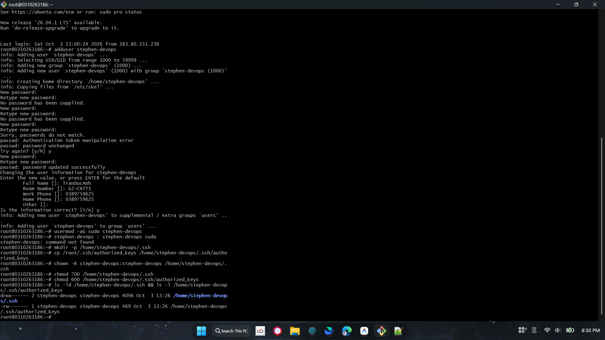
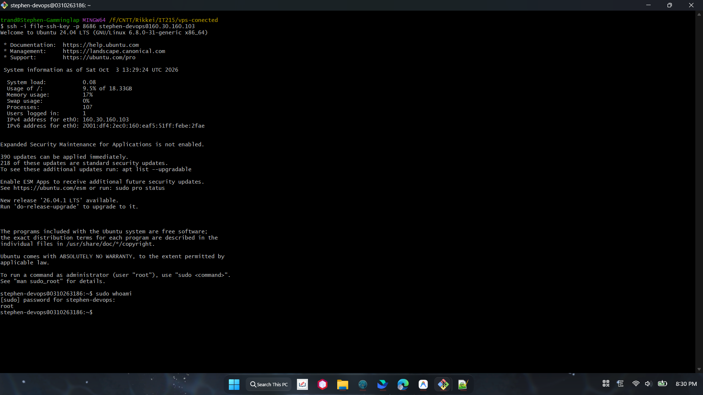

# BÀI TẬP 2: KHỞI TẠO USER THƯỜNG & THIẾT LẬP ĐẶC QUYỀN QUẢN TRỊ (SUDOERS CONFIGURATION)

**Mã bài tập:** SESSION 02 - EXERCISE 2 (ss02-ex2)  
**Môn học:** IT215 - Cloud Infrastructure & DevOps Fundamentals  
**Tài khoản khởi tạo:** `stephen-devops`  
**Máy chủ:** Ubuntu 24.04 LTS (`160.30.160.103:8686`)  

---

## 1. MỤC TIÊU

- Tạo tài khoản người dùng thường (Non-root user) để vận hành máy chủ hàng ngày theo nguyên tắc đặc quyền tối thiểu (Least Privilege), hạn chế rủi ro thao tác trực tiếp bằng `root`.
- Cấp quyền quản trị thông qua nhóm `sudo`.
- Sao chép cấu hình SSH Key từ `root` sang user mới và phân quyền an toàn để đăng nhập bằng SSH Key từ máy cá nhân.
- Kiểm tra đăng nhập và thực thi lệnh kiểm tra đặc quyền `sudo whoami`.

---

## 2. CÁC BƯỚC TRIỂN KHAI

### Bước 1: Khởi tạo người dùng mới
Đăng nhập vào server với quyền `root` và tạo tài khoản `stephen-devops`:
```bash
adduser stephen-devops
```
*Nhập mật khẩu và các thông tin định danh người dùng (TranDucAnh - G2-CNTT1).*

### Bước 2: Thêm user vào nhóm quản trị sudo
```bash
usermod -aG sudo stephen-devops
```

### Bước 3: Sao chép SSH Key và phân quyền bảo mật
Tạo thư mục `.ssh`, sao chép khóa `authorized_keys` từ root, đổi quyền sở hữu và phân quyền nghiêm ngặt:
```bash
mkdir -p /home/stephen-devops/.ssh
cp /root/.ssh/authorized_keys /home/stephen-devops/.ssh/authorized_keys
chown -R stephen-devops:stephen-devops /home/stephen-devops/.ssh/
chmod 700 /home/stephen-devops/.ssh
chmod 600 /home/stephen-devops/.ssh/authorized_keys
```

Kiểm tra lại quyền thư mục và tệp:
```bash
ls -ld /home/stephen-devops/.ssh && ls -l /home/stephen-devops/.ssh/authorized_keys
```
- Thư mục `.ssh`: `drwx------` (700), owner `stephen-devops:stephen-devops`
- File `authorized_keys`: `-rw-------` (600), owner `stephen-devops:stephen-devops`

---

## 3. KIỂM TRA TỪ MÁY CÁ NHÂN

### 1. Đăng nhập SSH bằng tài khoản mới
Mở Terminal máy cá nhân và kết nối tới server bằng khóa SSH:
```bash
ssh -i file-ssh-key -p 8686 stephen-devops@160.30.160.103
```
$\rightarrow$ Đăng nhập thành công vào giao diện dòng lệnh `stephen-devops@0310263186:~$`.

### 2. Kiểm tra đặc quyền sudo
Thực thi lệnh kiểm tra quyền root:
```bash
sudo whoami
```
$\rightarrow$ Nhập mật khẩu của user `stephen-devops`, hệ thống trả về kết quả: **`root`**.

---

## 4. HÌNH ẢNH MINH CHỨNG & LOG TERMINAL

### Minh chứng 1: Tạo user, cấp quyền sudo, copy SSH key và phân quyền



**Log thao tác trên máy chủ (Root):**
```text
root@0310263186:~# adduser stephen-devops
info: Adding user `stephen-devops' ...
info: Selecting UID/GID from range 1000 to 59999 ...
info: Adding new group `stephen-devops' (1000) ...
info: Adding new user `stephen-devops' (1000) with group `stephen-devops (1000)'
info: Creating home directory `/home/stephen-devops' ...
info: Copying files from `/etc/skel' ...
New password: 
Retype new password: 
passwd: password updated successfully
Changing the user information for stephen-devops
Enter the new value, or press ENTER for the default
	Full Name []: TranDucAnh
	Room Number []: G2-CNTT1
	Work Phone []: 0389759625
	Home Phone []: 0389759625
	Other []: 
Is the information correct? [Y/n] y
info: Adding new user `stephen-devops' to supplemental / extra groups `users' ..
info: Adding user `stephen-devops' to group `users' ...
root@0310263186:~# usermod -aG sudo stephen-devops
root@0310263186:~# mkdir -p /home/stephen-devops/.ssh
root@0310263186:~# cp /root/.ssh/authorized_keys /home/stephen-devops/.ssh/authorized_keys
root@0310263186:~# chown -R stephen-devops:stephen-devops /home/stephen-devops/.ssh
root@0310263186:~# chmod 700 /home/stephen-devops/.ssh
root@0310263186:~# chmod 600 /home/stephen-devops/.ssh/authorized_keys
root@0310263186:~# ls -ld /home/stephen-devops/.ssh && ls -l /home/stephen-devops/.ssh/authorized_keys
drwx------ 2 stephen-devops stephen-devops 4096 Oct  3 13:26 /home/stephen-devops/.ssh
-rw------- 1 stephen-devops stephen-devops  469 Oct  3 13:26 /home/stephen-devops/.ssh/authorized_keys
```

---

### Minh chứng 2: Đăng nhập SSH bằng user mới và chạy `sudo whoami`



**Log kiểm tra từ Terminal máy cá nhân:**
```text
trand@Stephen-Gamminglap MINGW64 /f/CNTT/Rikkei/IT215/vps-conected
$ ssh -i file-ssh-key -p 8686 stephen-devops@160.30.160.103
Welcome to Ubuntu 24.04 LTS (GNU/Linux 6.8.0-31-generic x86_64)

 * Documentation:  https://help.ubuntu.com
 * Management:     https://landscape.canonical.com
 * Support:        https://ubuntu.com/pro

System information as of Sat Oct  3 13:29:24 UTC 2026

  System load:                      0.08
  Usage of /:                       9.5% of 18.33GB
  Memory usage:                     17%
  Swap usage:                       0%
  Processes:                        107
  Users logged in:                  1
  IPv4 address for eth0:            160.30.160.103
  IPv6 address for eth0:            2001:df4:2ec0:160:eaf5:51ff:febe:2fae

Expanded Security Maintenance for Applications is not enabled.

390 updates can be applied immediately.
218 of these updates are standard security updates.
To see these additional updates run: apt list --upgradable

Enable ESM Apps to receive additional future security updates.
See https://ubuntu.com/esm or run: sudo pro status

New release '26.04.1 LTS' available.
Run 'do-release-upgrade' to upgrade to it.


The programs included with the Ubuntu system are free software;
the exact distribution terms for each program are described in the
individual files in /usr/share/doc/*/copyright.

Ubuntu comes with ABSOLUTELY NO WARRANTY, to the extent permitted by
applicable law.

To run a command as administrator (user "root"), use "sudo <command>".
See "man sudo_root" for details.

stephen-devops@0310263186:~$ sudo whoami
[sudo] password for stephen-devops: 
root
stephen-devops@0310263186:~$ 
```

---

## 5. KẾT LUẬN

- Khởi tạo thành công tài khoản người dùng thường `stephen-devops` và cấp quyền quản trị trong nhóm `sudo`.
- Phân quyền tệp và thư mục SSH đạt chuẩn bảo mật OpenSSH (`700` và `600`).
- Đăng nhập SSH từ máy cá nhân bằng cặp khóa SSH thành công mà không dùng mật khẩu thô.
- Thực thi lệnh `sudo whoami` thành công, xác nhận quyền quản trị hệ thống an toàn.
